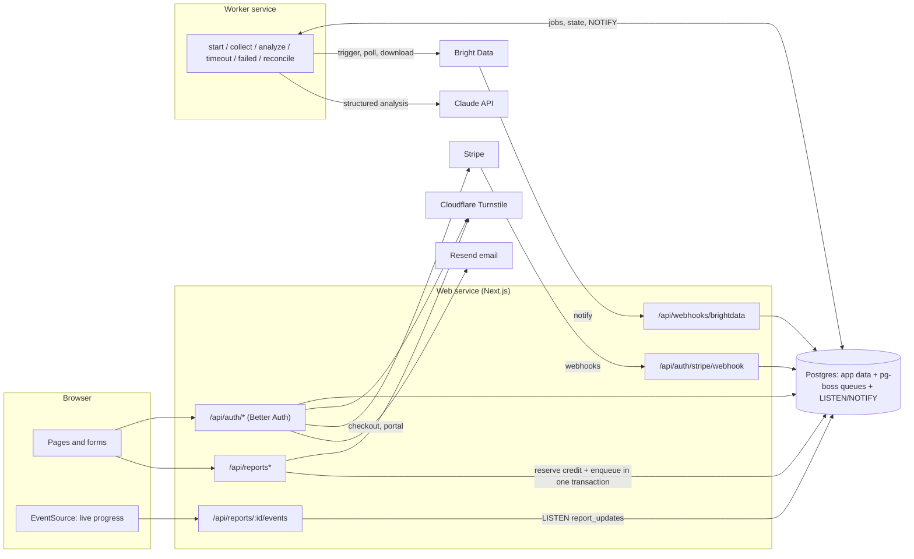
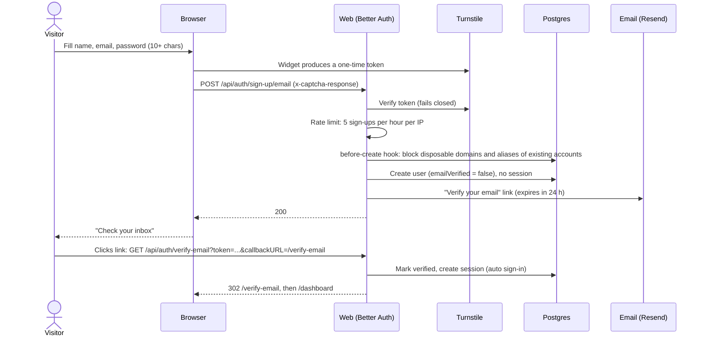
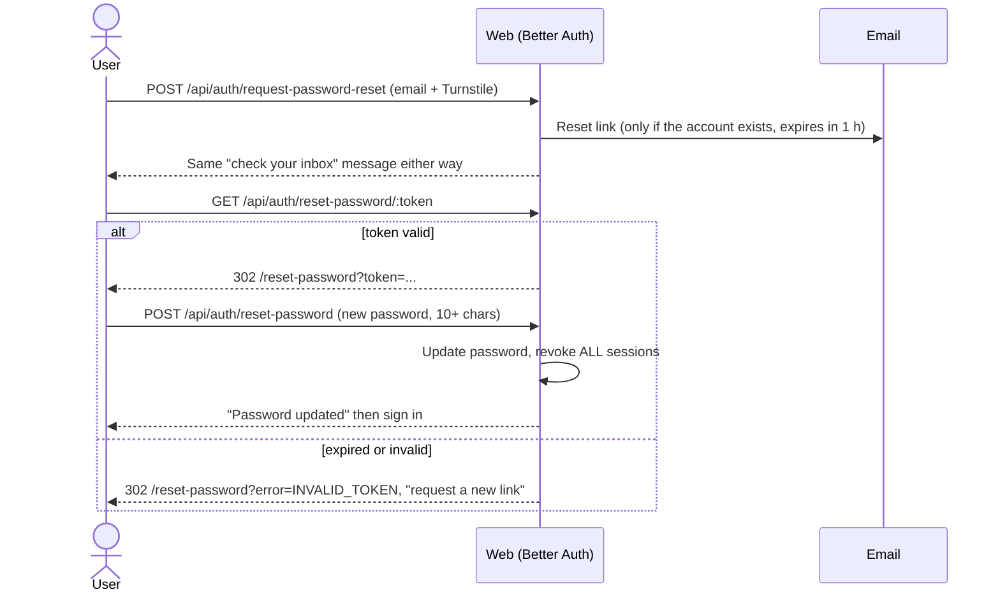
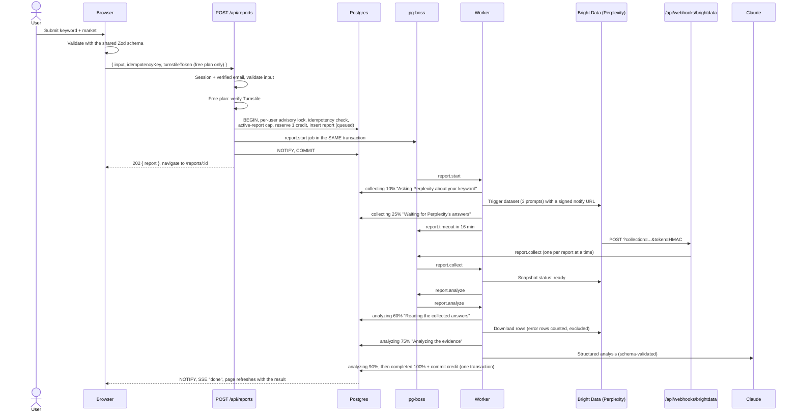
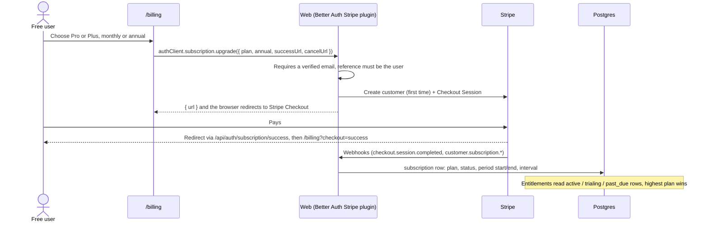
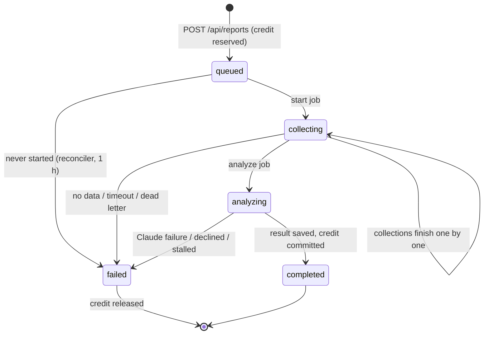
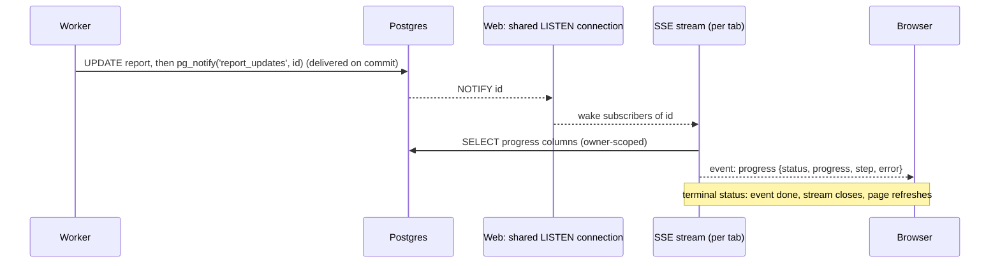

# AISEO: user journeys and system flows

This document describes every path a person can take through AISEO and the background flows that support them: what the user sees, what the system does, and what happens when something goes wrong. It describes the code as built; file references point to where each behavior lives.

**Contents**

1. [Concepts](#1-concepts)
2. [System at a glance](#2-system-at-a-glance)
3. [Page map](#3-page-map)
4. User journeys
   - [J1. Visitor explores the product](#j1-visitor-explores-the-product)
   - [J2. Sign up and verify email](#j2-sign-up-and-verify-email)
   - [J3. Sign in](#j3-sign-in)
   - [J4. Forgot and reset password](#j4-forgot-and-reset-password)
   - [J5. Run a keyword report](#j5-run-a-keyword-report)
   - [J6. Run an AI visibility scan](#j6-run-an-ai-visibility-scan)
   - [J7. Watch live progress, leave, come back](#j7-watch-live-progress-leave-come-back)
   - [J8. Read a finished report](#j8-read-a-finished-report)
   - [J9. A report fails](#j9-a-report-fails)
   - [J10. Hitting limits](#j10-hitting-limits)
   - [J11. Browse report history](#j11-browse-report-history)
   - [J12. Upgrade to a paid plan](#j12-upgrade-to-a-paid-plan)
   - [J13. Change plan, switch billing period, cancel](#j13-change-plan-switch-billing-period-cancel)
   - [J14. A payment fails](#j14-a-payment-fails)
   - [J15. Account settings and signing out](#j15-account-settings-and-signing-out)
5. System flows
   - [S1. Report state machine](#s1-report-state-machine)
   - [S2. Credits: reserve, commit, release](#s2-credits-reserve-commit-release)
   - [S3. Bright Data delivery webhook](#s3-bright-data-delivery-webhook)
   - [S4. Collection timeouts and partial data](#s4-collection-timeouts-and-partial-data)
   - [S5. Retries and dead letters](#s5-retries-and-dead-letters)
   - [S6. The reconciler](#s6-the-reconciler)
   - [S7. Stripe webhooks and entitlements](#s7-stripe-webhooks-and-entitlements)
   - [S8. Live progress plumbing](#s8-live-progress-plumbing)
   - [S9. Email](#s9-email)
   - [S10. Abuse and cost controls](#s10-abuse-and-cost-controls)
6. [Guarantees and edge cases](#6-guarantees-and-edge-cases)
7. [Where each journey lives in the code](#7-where-each-journey-lives-in-the-code)

---

## 1. Concepts

| Term | Meaning |
|---|---|
| **Keyword report** | Asks Perplexity three questions about a keyword in a chosen market. The report shows which domains and brands the answers rely on, an opportunity score, prompts to target and keyword clusters. |
| **Visibility scan** | Asks ChatGPT (with web search) and Gemini five neutral buyer questions in the user's category. The report measures how often the user's brand is mentioned and their site cited. |
| **Credit** | One unit of a plan's allowance. Every report uses one credit of its type (keyword or visibility). |
| **Allowance** | Credits per plan. Free: 2 keyword + 2 visibility, once (lifetime). Pro: 100 + 25 per month. Plus: 500 + 100 per month. Defined in `src/server/billing/plans.ts`. |
| **Reservation** | A credit is *reserved* when a report starts, *committed* when it completes and *released* (refunded) when it fails. Each happens exactly once. |
| **Insights** | Paid result sections: key findings, content gaps, quick wins and a content plan (keyword reports); prioritized recommendations (visibility scans). |
| **Tier** | The plan a report was created on. It decides whether insights are *generated*. The viewer's current plan decides whether they are *shown*. |
| **Collection / snapshot** | One Bright Data scrape job (one per AI platform per report). Bright Data calls our webhook when it finishes. |
| **Web / worker** | Two processes from one codebase. The web service (Next.js) serves pages and APIs. The worker (`src/worker/index.ts`) runs the report pipeline jobs. |

## 2. System at a glance

Postgres is the only stateful dependency. It holds application tables, the job queue (pg-boss, schema `pgboss`) and the live-progress channel (`LISTEN/NOTIFY` on `report_updates`). There is no Redis.

## 3. Page map

| Route | Who | Purpose |
|---|---|---|
| `/` | anyone | Landing page |
| `/pricing` | anyone | Plans with a monthly/annual toggle; every button goes to sign-up |
| `/sign-up` | signed out | Create account (Turnstile) |
| `/sign-in` | signed out | Sign in (Turnstile); honors `?next=` |
| `/verify-email` | anyone | Where verification links land; explains bad links; resend form |
| `/forgot-password` | anyone | Request a reset link (Turnstile) |
| `/reset-password` | anyone with a link | Choose a new password |
| `/dashboard` | signed in | Allowance meters, upgrade prompt, recent reports, billing alerts |
| `/keywords` | signed in | New keyword report form and recent keyword reports |
| `/visibility` | signed in | New visibility scan form and recent scans |
| `/reports` | signed in | Full history with type filter and pagination |
| `/reports/:id` | owner only | Live progress, results, or failure details |
| `/billing` | signed in | Plan, allowance, upgrade/switch, Stripe portal |
| `/settings` | signed in | Name, password, sign out other devices |

`src/proxy.ts` redirects requests without a session cookie from signed-in routes to `/sign-in?next=<path>`. This is only a convenience: every page and API route checks the session again on the server (`src/server/web/session.ts`, `src/server/web/api.ts`).

---

## 4. User journeys

### J1. Visitor explores the product

1. The landing page (`/`) explains both products and the free allowance. Its CTA is "Start free: 2 keyword + 2 visibility reports".
2. `/pricing` lists Free, Pro and Plus from `plans.ts` (the same data the quota system enforces). Annual pricing gives 2 months free. Every button leads to `/sign-up`; plans are bought after sign-up from `/billing`.
3. Both pages are static and need no database.

### J2. Sign up and verify email

What the user sees and what can go wrong:

- **Invalid form input**: the client checks password length; Better Auth validates email format and password length (10–128).
- **Security check not completed**: "Please complete the security check." The token is single-use, so the widget re-mounts after every failed attempt.
- **Disposable email** (e.g. mailinator): "Please use a permanent email address." (`src/server/auth/email-policy.ts`, list from `disposable-email-domains`).
- **Email already registered, or an alias of one**: `jane@gmail.com` again, or `jane+1@gmail.com` / `j.a.n.e@gmail.com` when `jane@gmail.com` exists. No account is created, so one inbox can't collect free credits repeatedly (normalization strips `+tags` everywhere and dots for Gmail, and the normalized email has a unique index). The response is identical to a successful sign-up (the password is hashed anyway so timing matches), so nobody can probe which emails have accounts. Instead, the inbox owner gets a "You already have an AISEO account" email with sign-in and password-reset links.
- **Protected fields**: sign-up and profile updates reject `stripeCustomerId`, `emailVerified` and `normalizedEmail` in the request body (`src/server/auth/auth.ts`).
- **Too many sign-ups from one IP**: HTTP 429 from the auth rate limiter (stored in the `rate_limit` table, so it works across instances).
- **Verification link expired or reused**: Better Auth redirects to `/verify-email?error=TOKEN_EXPIRED` (or `INVALID_TOKEN`). The page explains the problem and offers a resend form (rate limited to 3 per 10 minutes per IP). All verification links land on `/verify-email` regardless of which flow sent them (`src/server/auth/auth.ts`). A verified, signed-in visitor there is forwarded to `/dashboard`.
- **Opening the link on another device** works: verification signs that device in.

### J3. Sign in

1. `/sign-in` checks the real session first and sends signed-in users to `next` (default `/dashboard`). `next` must be a same-site path (`safeNextPath`), which blocks open redirects.
2. The user submits email, password and the Turnstile token. Better Auth rate limits sign-in to 10 per minute per IP.
3. Outcomes:
   - **Success**: Better Auth sets the session cookie (7-day session, refreshed daily; a 5-minute signed cookie cache saves database lookups). The browser does a full navigation to `next`, so every server component renders with the new session.
   - **Wrong email or password**: "Invalid email or password". The response doesn't reveal whether the account exists.
   - **Email not verified** (HTTP 403): Better Auth sends a fresh verification email and the form says "Verify your email to sign in. We just sent you a new verification link."
4. A visitor with a stale session cookie (e.g. revoked by a password reset) who opens a signed-in page is sent to `/sign-in` by the server-side check. The sign-in page shows the form because there is no valid session, so there is no redirect loop.

### J4. Forgot and reset password

Requests are rate limited to 5 per hour per IP. Every existing session is revoked on reset, so a thief signed in elsewhere is signed out.

### J5. Run a keyword report

The user opens `/keywords`, enters a keyword (2–100 characters) and a market (one of 20 countries), and submits.

How the result is built (`src/server/pipeline/keyword.ts`):

- The three Perplexity prompts are the keyword itself, "most trusted sources and leading brands for …", and "what questions do people ask about …".
- **Counted by code** (authoritative): cited URLs, unique domains, each domain's share of citations, how often each competitor is mentioned (whole-word matching) and their share, and the coverage line (answers, sources, domains, failed rows).
- **Judged by Claude** (schema-validated): domain categories, a summary, competitor names, prompt ideas, keyword clusters, the score components and, on paid tiers only, insights.
- **Opportunity score** is the sum of five clamped components: demand (0–25), question diversity (0–20), content depth opportunity (0–20), competitive opening (0–20) and evidence strength (0–15, capped at 3 when the answers cited no sources). Labels: Needs work (<40), Promising (40–64), Strong (65–84), Excellent (85+).

### J6. Run an AI visibility scan

The user opens `/visibility` and enters a website (normalized to `https://host/path`; IPs and `localhost` are rejected), a brand name (2–80) and a category (3–160). The flow matches J5, except:

1. **Prompt generation** (start job, progress 10%, "Writing neutral customer prompts"): Claude writes exactly five buyer questions, one per intent (recommendation, use case, alternatives, comparison, purchase). Any prompt that mentions the brand, the domain or its root label is discarded. If fewer than five survive, the step is retried. Prompts are saved on the report before any scraping, so a retry never pays for a second set.
2. **Two collections** run in parallel: ChatGPT (web search on, so answers carry citations) and Gemini. Progress shows "Got ChatGPT answers, waiting for the rest" when one finishes first.
3. **Scoring** (`src/server/pipeline/visibility.ts`), all computed by code:
   - *mentioned*: the answer names the brand or the domain (whole-word match);
   - *cited*: any cited URL's host matches the website's host;
   - per-platform score = 60 × mention rate + 40 × citation rate, over the prompts that actually got an answer;
   - overall score = average of the platforms that returned at least one answer. Labels: Hidden (<10), Low (<35), Moderate (<65), Strong (<85), Dominant.
4. Prompts whose answer failed to collect show "No answer collected (excluded from the score)" and don't count against the brand. If neither platform returns a usable answer, the report fails with `NO_USABLE_ANSWERS` and the credit is refunded.
5. Claude writes the summary and names competing brands (whose mentions are then counted by code), plus 3–4 recommendations on paid tiers.

### J7. Watch live progress, leave, come back

- `/reports/:id` for an active report shows a live card: spinner, current step, percentage bar and a note that the user can leave.
- The card subscribes to `GET /api/reports/:id/events` (server-sent events). Each pipeline step writes the report row and sends `pg_notify('report_updates', id)`. Every web instance holds **one** `LISTEN` connection that fans notifications out to its open streams. A stream re-reads the row and sends a `progress` event only when something changed, in order.
- When the report finishes, the stream sends `done` and the page refreshes into the finished report or the failure card.
- **Resilience**: heartbeats every 20 s keep proxies from closing the stream, and each heartbeat also re-reads the report, so a missed notification delays an update by at most 20 s. The `LISTEN` connection uses TCP keep-alive, so a half-open connection errors and reconnects instead of going silent. The server closes each stream after 13 minutes (Railway caps responses at 15) and the browser reconnects after 3 s, picking up the current state. If the stream fails more than four times in a row, or can't connect, the card falls back to polling `GET /api/reports/:id` every 5 seconds. If the `LISTEN` connection drops, it reconnects with backoff and wakes every open stream to re-read.
- **Leaving** is safe: the pipeline doesn't depend on the browser. Reports appear in `/dashboard`, `/keywords` or `/visibility`, and `/reports` with their current status. Opening one later shows the live card or the result.

### J8. Read a finished report

- **Keyword report**: opportunity score with its five components, coverage line, most-cited domains table, source mix, competing brands (Leading/Established/Emerging by share of mentions), prompts to target (High/Medium/Low opportunity), keyword clusters, then the insights section.
- **Visibility scan**: overall score, per-platform cards (mentions, citations, unavailable answers), prompt-by-prompt results with excerpts around the brand mention, other brands named, then recommendations.
- **The paywall is enforced on the server** (`src/server/reports/serialize.ts`). Paid sections are removed from the response unless the viewer's current plan includes insights. The paid section then renders in one of three states:

| Viewer's plan | Report created on | Paid section shows |
|---|---|---|
| Free | Free | "Included in every report you run on Pro or Plus" with a "See plans" link (upgrading can't add sections to this report) |
| Free | Pro/Plus (user later downgraded) | "Upgrade to unlock" (content exists but is not sent) |
| Pro/Plus | Pro/Plus | The insights |
| Pro/Plus | Free (user upgraded later) | "This report ran on the Free plan, so it doesn't include this section. New reports on your plan do." |

- Stored results are validated against a versioned schema on every read. A result that fails validation is logged and the page says it can't be displayed rather than crashing.

### J9. A report fails

Every failure releases the reservation, so **a failed report never uses a credit**. The report page shows the reason and a **Try again** button that opens the right form prefilled with the same input.

| Code | When | Message shown |
|---|---|---|
| `COLLECTION_FAILED` | Bright Data rejected the request, or every collection ended without data | We couldn't collect AI answers for this report. |
| `NO_USABLE_ANSWERS` | Answers arrived but all rows were errors | The AI platforms returned no usable answers for this request. |
| `TIMED_OUT` | No collection finished within 45 minutes | Collecting AI answers took too long. |
| `ANALYSIS_FAILED` | Claude analysis kept failing, or analysis stalled | We couldn't analyze the collected answers. |
| `ANALYSIS_DECLINED` | Claude declined the request (after the server-side refusal fallback) | The analysis model declined this request. Try rephrasing it. |
| `PROMPTS_FAILED` | Neutral prompts couldn't be generated | We couldn't prepare neutral test prompts for this topic. Try a broader topic. |
| `CONFIGURATION` | Invalid provider credentials (401/403) | Report generation is temporarily unavailable. |
| `INTERNAL` | Anything else, or a job that never started | Something went wrong while generating this report. |

Every message ends with "Your credit has been refunded." Internal details (provider responses, stack traces) are stored in `report.failure_detail` and logs only; they are never sent to the browser.

To see the refund path locally (fake providers only), use a keyword or topic containing `simulate failure`.

### J10. Hitting limits

| Situation | Response | What the user sees |
|---|---|---|
| Out of credits for that report type | 403 `LIMIT_REACHED` | Free: "You've used your free keyword reports. Upgrade to keep going." Paid: "…Upgrade or wait for your allowance to reset." Forms show an out-of-credits banner and disable the button. |
| 3 reports already running | 429 `TOO_MANY_ACTIVE` | "You can run 3 reports at a time. Wait for one to finish and try again." (`MAX_ACTIVE_REPORTS_PER_USER`) |
| 5 input-caused failures in 24 hours | 429 `TOO_MANY_FAILURES` | "Several of your recent reports couldn't be completed, so new reports are paused for up to 24 hours." Counts only refunded failures a user's input can cause after money was spent (`NO_USABLE_ANSWERS`, `ANALYSIS_DECLINED`, `PROMPTS_FAILED`); provider outages don't count. (`MAX_FAILED_REPORTS_PER_DAY`) |
| Double-click, retry after a network error | 200 with the existing report | The same report opens; no second credit is used. The form keeps one idempotency key per submission attempt and resets it when the input changes. |
| Free user without a valid Turnstile token | 403 `CAPTCHA_FAILED` | "Please complete the security check and try again." |
| Invalid input | 400 `INVALID_INPUT` + field errors | Messages under each field (the same Zod schema runs in the browser and on the server). |
| Session expired | 401 | Sent to sign-in with `next` set to the current page. |

Allowance meters on the dashboard and billing page show remaining credits, reports currently running (reserved credits) and the reset date (paid) or "Free allowance" (free).

### J11. Browse report history

- `/reports` lists every report, newest first, 20 per page, with filters All / Keyword reports / Visibility scans. "Older reports" uses a keyset cursor, so pages stay stable while new reports arrive.
- Rows show the title, type, date (UTC), the live step for running reports, the score badge for completed ones, and "Failed · credit refunded" for failures.
- Reports are scoped to their owner in every query. Another user's report id returns "Not found" (no hint that it exists).

### J12. Upgrade to a paid plan

After paying:

- The plan badge, dashboard and billing page show the new plan. If the page loads before Stripe's webhook arrives, the billing page says it may take a few seconds.
- **The allowance switches immediately.** Paid credits come from a new bucket for the paid plan and the current billing window, so an upgraded user gets the full monthly allowance at once. Free credits already used don't count against it.
- **Allowances reset every billing month.** On monthly billing the window is exactly Stripe's billing period, so it resets on each renewal, including month-end anchors (Jan 31 → Feb 28 → Mar 31). On annual billing there are 12 monthly windows counted from the start of the billing year (days past the end of a short month are clamped), never running past the year's end. Unused credits don't roll over.
- New reports are created with the paid tier, so they include insights.
- Canceling Checkout returns to `/billing?checkout=canceled`: "Checkout was canceled. You haven't been charged."

### J13. Change plan, switch billing period, cancel

- **Pro → Plus or Plus → Pro**: the Stripe plugin sends existing subscribers to the Stripe billing portal to confirm the change (with proration). The new plan's monthly allowance applies at once (it's a separate bucket per plan and window). If the user had already used some of the target plan's allowance earlier in the same window, that usage still counts.
- **Monthly ↔ annual**: the same flow with the annual price. The billing page labels it "Switch to annual billing" or "Switch to monthly billing". The current combination shows a disabled "Current plan" button. Stripe restarts the billing period on an interval change, but **the allowance doesn't restart**: the current window's bucket stays in use (extended to the new window's end), so toggling the interval can't mint extra credits.
- **Past-due subscriptions** can't change plans: Stripe's plugin would open a second subscription in Checkout. The billing page hides plan changes and asks the user to update their payment method first.
- **Manage billing** opens the Stripe billing portal (update card, see invoices, cancel).
- **Cancel**: done in the portal. Stripe keeps the subscription active until the period ends (`cancelAtPeriodEnd`). The dashboard and billing page say "Your Pro plan ends on <date>". The user keeps paid access and their remaining credits until then, and can resume from the portal. When the period ends, Stripe sends `customer.subscription.deleted`, the subscription row is no longer active, and the user is on Free.
- **After downgrading to Free**: the user is back on the free lifetime bucket (whatever remains of the original 2 + 2). Paid sections of old reports are hidden ("Upgrade to unlock") but not deleted.

### J14. A payment fails

1. Stripe fails to charge a renewal and marks the subscription `past_due`. **The user keeps paid access** while Stripe retries (Smart Retries / dunning, configured in Stripe).
2. Our webhook handler (`src/server/billing/stripe-events.ts`) receives `invoice.payment_failed` and emails the user a link to `/billing`. The event id is recorded in the same transaction as the email: Stripe's duplicates are skipped, but if sending fails the record rolls back and Stripe's retry sends it.
3. In the app, the dashboard shows "Your last payment failed" with a link to billing. The billing page marks the plan "Payment failed", its button reads **Update payment method** (Stripe portal), and plan changes are paused until the invoice is paid.
4. If a retry succeeds, the status returns to `active` and nothing else changes. If retries are exhausted, Stripe cancels the subscription or marks it `unpaid` (depending on the Stripe settings), and the user drops to Free.

### J15. Account settings and signing out

- **Profile**: change the display name (2–80 characters). The email address is shown read-only.
- **Password**: requires the current password. A successful change signs out all other devices.
- **Devices**: "Sign out other devices" revokes every other session.
- **Sign out** (header or mobile menu): ends the session, then reloads to `/sign-in` so no signed-in page stays in the browser cache.

---

## 5. System flows

### S1. Report state machine

All status changes go through `src/server/reports/state.ts`. Every write only applies while the report is still active (`queued`, `collecting`, `analyzing`). A late retry, a duplicate webhook or the reconciler therefore can't overwrite a finished report. Progress uses `greatest()` so it never goes backwards. Completion and failure each settle the credit in the same transaction as the status change. (`canceled` exists in the schema and UI for operator use. There is no user-facing cancel button yet.)

### S2. Credits: reserve, commit, release

- **Buckets** (`usage_bucket`): one row per user, feature, plan and window, with `quota`, `used` and `reserved`. A `CHECK (used + reserved <= quota)` constraint backs up the application logic.
- **Reserve** (`reserveUnit`): a single conditional `UPDATE … SET reserved = reserved + 1 WHERE used + reserved < quota`. Under concurrency, Postgres row locking re-checks the condition, so two parallel requests can never both take the last credit (tested with 25 concurrent reservations against a quota of 2).
- **Create** (`createReport`): one transaction holds a per-user advisory lock and performs the idempotency check, the active-report cap, the reservation, the report insert and the pipeline job insert. It all commits or none of it does.
- **Settle** (`settleReservation`): flips `report.quota_state` from `reserved` to `committed` or `released` with a guarded `UPDATE`, then adjusts the bucket. A second settle finds nothing to flip, so retries, timeouts and the reconciler can call it safely.
- **Windows** (`src/server/quota/windows.ts`): free uses one lifetime window. Monthly billing uses Stripe's current period; annual billing uses monthly windows from the start of the billing year, capped at its end; with no period yet, the UTC calendar month. If a renewal webhook is late, the next window starts exactly at the old period's end, so it maps to the same bucket once the renewal arrives.
- **Bucket reuse** (`ensureBucket`): a paid window reuses any bucket of the same plan that overlaps it (and extends its end) instead of opening a new one. Interval switches move Stripe's anchor, and this keeps the allowance from restarting mid-window.

### S3. Bright Data delivery webhook

1. When a collection is triggered, the worker registers `/api/webhooks/brightdata?collection=<id>&token=<HMAC-SHA256(id)>` as the notify URL (`src/server/pipeline/webhook-token.ts`).
2. On delivery, the route verifies the token with a constant-time comparison. An invalid token gets 401; a valid token for an unknown collection gets 200 so Bright Data stops retrying.
3. The request body is ignored. The route only enqueues `report.collect` with `singletonKey = reportId`, so a burst of duplicate notifications becomes one job. The collect job asks Bright Data's API for the snapshot status, which stays the source of truth.

### S4. Collection timeouts and partial data

- The start job arms `report.timeout` 16 minutes out (`COLLECTION_TIMEOUT_MINUTES`). It covers lost webhooks: the timeout polls Bright Data itself.
- If collections are still running, the timeout re-arms every 5 minutes until 45 minutes (`COLLECTION_MAX_WAIT_MINUTES`). The next check is queued *before* polling, so a failing poll can't break the chain.
- At the limit, still-running snapshots are canceled, even if Bright Data can't be polled at that moment. If at least one platform delivered (e.g. ChatGPT answered, Gemini stuck), the report is analyzed with what arrived; otherwise it fails with `TIMED_OUT`.

### S5. Retries and dead letters

- Every job runs through `runReportJob`. A `NonRetryableError` (bad credentials, refusal, empty data, invalid request) fails the report immediately with its code. Any other error is recorded in `failure_detail` and rethrown so pg-boss retries with backoff.
- Queue policies (`src/server/pipeline/queues.ts`): `start` and `analyze` are *exclusive* (one job per report at a time); `collect` is *stately* (one queued plus one active per report).
- Job expiry always exceeds the work's worst case, so pg-boss never starts a second attempt while the first is still paying: `start` gets 10 minutes (prompt generation is capped at 2), `analyze` 15 (each Claude request is capped at 4). The Anthropic SDK's own retries are off, because they can wait out a long `retry-after`; jobs retry with bounded backoff instead.
- When retries run out on `start` or `analyze`, pg-boss moves the job to `report.failed`. The dead-letter handler fails the report with a code inferred from where it stopped (`PROMPTS_FAILED`, `ANALYSIS_FAILED`, `COLLECTION_FAILED` or `INTERNAL`), releases the credit and cancels outstanding snapshots. `collect` has no dead letter: it's only a hint, and the timeout chain still finishes the report.
- Retries never pay twice for the expensive steps: visibility prompts are persisted; the report is re-checked before every trigger, so nothing is bought after it ended; a collection is claimed atomically, and a snapshot triggered by a losing parallel attempt is canceled at once; status and progress only move forward; completion is guarded. Every permanent failure (including one mid-way through `start`) cancels snapshots already triggered.

### S6. The reconciler

A cron job (`report.reconcile`, every 5 minutes, one instance at a time) repairs anything the event-driven path missed:

| Finds | Does |
|---|---|
| Any active report older than 2 h 45 min (max wait + 2 h) | Fails it (`TIMED_OUT`, or `ANALYSIS_FAILED` if analyzing) and cancels its snapshots. A hard cap by age: retries that keep failing also keep `updated_at` fresh. |
| `queued` for more than 10 minutes | Re-sends the start job; after an hour, fails it (`INTERNAL`) |
| `collecting` with no update for 60 minutes | Sends a final timeout check |
| `analyzing` with no update for 45 minutes | Fails it (`ANALYSIS_FAILED`) |
| Finished reports still holding a reservation | Commits (completed) or releases (failed/canceled) it |

### S7. Stripe webhooks and entitlements

- Stripe calls `/api/auth/stripe/webhook`. The Better Auth Stripe plugin verifies the signature (`STRIPE_WEBHOOK_SECRET`) and keeps the `subscription` table in sync: plan, status, period start/end, billing interval, cancel-at-period-end.
- The plugin applies each event's snapshot in arrival order and swallows its own errors, which on its own could leave a stale row (Stripe doesn't guarantee order). So our `onEvent` hook re-fetches the subscription from Stripe after every subscription or checkout event and writes its current status, period, interval, plan and cancellation fields. This is idempotent and converges whatever the delivery order. If Stripe can't be reached, the hook throws, the endpoint answers 400 and Stripe retries.
- Side effects such as the payment-failed email run once per event id (`webhook_event`), recorded in the same transaction so a failed send is retried.
- The webhook path is exempt from the auth rate limiter (Stripe sends bursts from a few IPs). Without `STRIPE_WEBHOOK_SECRET`, the plugin gets a random secret, so events can't be forged on non-production deployments.
- **Entitlements** (`src/server/billing/entitlements.ts`) are computed per request from subscription rows with status `active`, `trialing` or `past_due` whose period ended less than 3 days ago; the highest plan wins. The 3-day cut-off means a row left `active` by a lost cancellation can't grant paid access indefinitely. Nothing else stores a "current plan".

### S8. Live progress plumbing

The `LISTEN` connection must be a direct Postgres connection, not a transaction-mode pooler. Payloads carry only the report id; the row is always re-read, so a missed or duplicated notification can't show wrong data.

### S9. Email

All email goes through `src/server/email/send.ts` (Resend) using the templates in `templates.ts`:

| Email | Trigger | Link lifetime |
|---|---|---|
| Verify your email | Sign-up, resend, sign-in attempt while unverified | 24 hours |
| Reset your password | Forgot password | 1 hour |
| Payment failed | `invoice.payment_failed` webhook | n/a (links to `/billing`) |
| You already have an account | Sign-up with an email (or alias) that already has an account | n/a (links to sign-in and reset) |

Without `RESEND_API_KEY` (local development), emails are printed to the web server's console so links can be opened directly. Production refuses to start without the key or with a placeholder `EMAIL_FROM` (Resend rejects unverified senders). Send failures are logged as `[email] send failed` even where the caller (Better Auth) swallows the error, and the resend and forgot-password forms show an error when the server can't send.

### S10. Abuse and cost controls

Each report costs real money (Bright Data scrapes and Claude tokens), so free usage is fenced in layers:

1. Turnstile on sign-up, sign-in and password reset, and on **every** report a free user creates. A misconfigured Turnstile secret is logged as a configuration error.
2. Email verification is required before any report can be created (API returns 403 `EMAIL_NOT_VERIFIED` otherwise).
3. Disposable email domains are blocked; aliases (`+tags`, Gmail dots) map to one normalized email with a unique index.
4. Rate limits on auth endpoints, stored in Postgres and keyed by the client IP from the platform's trusted header (`TRUSTED_IP_HEADER`, default `x-real-ip`).
5. Lifetime (not monthly) free allowance; per-user active-report cap; per-user advisory lock on creation; idempotency keys; a daily cap on refunded, input-caused failures.
6. `POST /api/reports` only accepts JSON from the app's own origin, so a sibling site can't spend a signed-in user's credits.
7. Paid insights are only generated for paid tiers, so free reports use less Claude output.

---

## 6. Guarantees and edge cases

| Scenario | Outcome |
|---|---|
| Two tabs submit at the same moment with one credit left | One report is created; the other gets `LIMIT_REACHED`. |
| User double-clicks Submit | One report (same idempotency key). |
| Browser closes mid-report | The report finishes in the background; the credit is committed only if it completes. |
| Worker crashes mid-job | pg-boss retries the job when it expires; handlers resume from saved state. |
| Web service restarts during a stream | The browser's EventSource reconnects and receives the current state. |
| Bright Data webhook never arrives | The timeout job polls Bright Data at 16 min, then every 5 min up to 45 min. |
| Webhook delivered three times | One collect job (stately queue + singleton key). |
| One platform fails, the other succeeds (visibility) | The report completes from the platform that answered; missing answers are excluded from scoring. |
| Claude refuses the analysis | The server-side refusal fallback retries on a fallback model first. If that also declines: `ANALYSIS_DECLINED`, credit refunded. |
| Report completes after the reconciler already failed it | Impossible: completion only applies to active reports. The late result is discarded and the credit stays released. |
| User upgrades while a free report is running | That report finishes as a free-tier report (no insights) and settles against the free bucket it reserved from. |
| Paid user downgrades | Old reports keep their data; paid sections show "Upgrade to unlock". |
| Annual subscriber, month 7 | Monthly allowance for the 7th window since the start of the billing year. |
| Subscription starts on the 31st | Monthly billing: one allowance per Stripe period (Jan 31 → Feb 28 → Mar 31). Annual: windows reset on the last day of shorter months, then return to the 31st. |
| User switches monthly → annual → monthly in a week | One allowance throughout; the next resets when the latest billing window ends. |
| Cancellation webhook lost or delivered out of order | The next subscription event re-syncs from Stripe; regardless, paid access stops 3 days after the recorded period end. |
| Two start attempts run at once (slow model) | One triggers each collection; the other's duplicate snapshot is canceled. |
| Viewing another user's report id | 404, indistinguishable from a missing report. |

## 7. Where each journey lives in the code

| Journey | Pages and components | Server |
|---|---|---|
| J2–J4 auth | `src/app/(auth)/*`, `src/components/auth/*`, `src/components/turnstile.tsx` | `src/server/auth/auth.ts`, `email-policy.ts`, `src/app/api/auth/[...all]/route.ts` |
| J5–J6 create | `src/app/(app)/keywords`, `src/app/(app)/visibility`, `src/components/reports/new-report-form.tsx` | `src/app/api/reports/route.ts`, `src/server/reports/create.ts`, `src/server/quota/*` |
| Pipeline | n/a | `src/worker/index.ts`, `src/server/pipeline/*` |
| J7 live progress | `src/components/reports/live-progress.tsx` | `src/app/api/reports/[id]/events/route.ts`, `src/server/web/realtime.ts` |
| J8 results | `src/app/(app)/reports/[id]`, `src/components/reports/*-report.tsx` | `src/server/reports/serialize.ts`, `results.ts` |
| J11 history | `src/app/(app)/reports/page.tsx`, `report-list.tsx` | `src/server/reports/queries.ts` |
| J12–J14 billing | `src/app/(app)/billing`, `src/components/billing/*` | Stripe plugin in `auth.ts`, `src/server/billing/*` |
| J15 settings | `src/app/(app)/settings`, `src/components/settings/*` | Better Auth endpoints |
| Data model | n/a | `src/server/db/schema/*`, `drizzle/` migrations |
